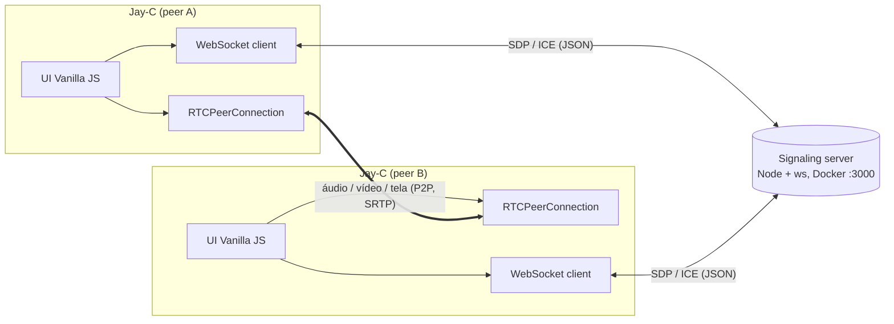
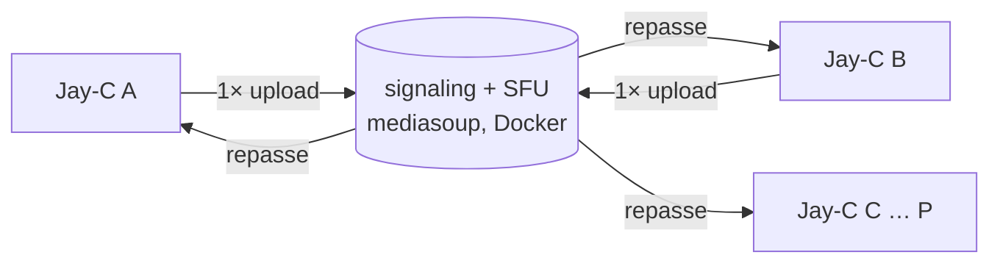

# Jay-C — Arquitetura

App leve e open-source de chamadas e compartilhamento de tela, para desktop e mobile, com servidor de sinalização self-hosted via Docker.

## 1. Visão geral



- O servidor **só troca mensagens de sinalização**: oferta, resposta e candidatos ICE. Mídia nunca passa por ele, então ele consome quase nada de CPU e RAM.
- A mídia vai direto entre os peers. Em LAN, ZeroTier ou Radmin VPN, os candidatos ICE do tipo *host* bastam, sem STUN ou TURN. Para uso pela internet sem VPN, o servidor repassa aos clientes os STUN/TURN definidos em `ICE_SERVERS`. Um serviço coturn opcional no compose fica para a etapa de release.
- Topologia atual: **mesh**, em que cada pessoa envia a própria mídia direto para cada uma das outras. Funciona até 4 pessoas.
- **Escopo final: salas de até 16 pessoas com SFU** (detalhes abaixo).

### Topologia final: SFU (até 16 pessoas)

Em mesh, cada participante envia N−1 cópias de cada faixa. Com 16 pessoas, quem transmite a tela em 1080p60 (~6 Mbps) precisaria de ~90 Mbps de upload. Com um **SFU** (*Selective Forwarding Unit*), cada pessoa envia **uma vez** para o servidor, que repassa para as outras sem decodificar.



| Tema | Escolha | Motivo |
|---|---|---|
| SFU | **mediasoup** (Node.js + worker em C++) no **mesmo container** do servidor de sinalização | Reaproveita o servidor Node e o protocolo próprio. O self-hosting continua sendo um único `docker compose up -d`. |
| Portas | **Uma porta UDP/TCP** para toda a mídia (`WebRtcServer` do mediasoup), além da 3000 da sinalização | É fácil de liberar no firewall, de mapear no Docker Desktop e de explicar no guia |
| IP anunciado | O servidor anuncia o IP/host que o cliente usou para conectar (cabeçalho `Host` do WebSocket) | O usuário não precisa configurar o IP no compose. Isso precisa ser validado na etapa do SFU. |
| Câmeras | **Simulcast** em 3 camadas | A grade de 16 recebe a camada baixa e quem está em destaque recebe a alta |
| Mesh | Removido quando o SFU entrar. Todas as salas passam pelo SFU. | Um só caminho de mídia para manter. Na LAN ou VPN, o salto extra pelo servidor é desprezível. |

Custo para quem hospeda: o servidor recebe cada faixa uma vez e reenvia para cada espectador. Uma tela em 1080p60 para 15 pessoas pede ~90 Mbps de **upload da máquina que hospeda**. Na LAN isso é tranquilo. Pela internet, via ZeroTier ou Radmin, o limite passa a ser a conexão do host, e o guia vai deixar isso claro.

## 2. Decisões técnicas

| Tema | Escolha | Motivo |
|---|---|---|
| Framework UI | **Vanilla JS + Vite** | Zero runtime de framework, menor memória e bundle. A UI é pequena: chamada, configurações e modal. |
| Shell | **Tauri v2** | Usa a WebView do sistema (WebView2, WKWebView, Android WebView) em vez de embutir o Chromium. |
| Servidor | **Node.js + `ws`** (não Socket.io) | O cliente usa o `WebSocket` nativo da WebView, sem lib extra no bundle. O protocolo é JSON simples e a imagem Docker fica mínima (`node:alpine`). |
| Negociação | Padrão **"perfect negotiation"** (W3C) | Resolve colisões de oferta (glare) e permite renegociar adicionando ou removendo faixas sem derrubar a chamada. |
| Troca de qualidade | `track.applyConstraints()` + `RTCRtpSender.setParameters()` | Muda resolução, FPS e bitrate **sem renegociar SDP**. Para trocar a fonte (câmera ↔ tela) usa `sender.replaceTrack()`, também sem renegociar. |
| Tema | CSS Custom Properties em `:root[data-theme]` | A troca é instantânea, só muda um atributo. Respeita `prefers-color-scheme` no primeiro uso. |
| Markdown do guia | Renderer próprio (~80 linhas) | O conteúdo é nosso e controlado. Basta suportar títulos, negrito, `code`, imagens e parágrafos, sem dependência extra. Escapa HTML por padrão. |
| Assets do guia | `frontend/public/assets/setup/*.png` | A pasta `public/` do Vite é servida na raiz pelo Tauri. `src-tauri/icons/` é só para ícones do app. |
| Áudio das transmissões | **Captura nativa** (WASAPI process loopback) num plugin Tauri | O `getDisplayMedia` não exclui apps do áudio do sistema nem captura áudio de janela. Detalhes na seção 6. |
| Persistência | `localStorage` | Guarda endereço do servidor, tema, preset de qualidade e nome. |

## 3. Estrutura do monorepo

```
JayC/
├─ package.json                 # npm workspaces: frontend, signaling-server, plugin guest-js
├─ docs/ARQUITETURA.md
├─ signaling-server/
│  ├─ src/server.js             # HTTP (/health) + WebSocketServer
│  ├─ src/rooms.js              # salas, peers, roteamento de mensagens
│  ├─ test/                     # node:test — join/leave/relay/limites
│  ├─ Dockerfile                # node:22-alpine, usuário não-root, HEALTHCHECK
│  ├─ docker-compose.yml        # porta 3000; coturn opcional (profile "turn")
│  └─ .dockerignore
├─ frontend/
│  ├─ index.html
│  ├─ vite.config.js
│  ├─ public/assets/setup/step1_docker.png … step5_connect.png
│  ├─ src/
│  │  ├─ main.js
│  │  ├─ styles/theme.css       # tokens claro/escuro
│  │  ├─ core/signaling.js      # WS client com reconexão + heartbeat
│  │  ├─ core/peer.js           # RTCPeerConnection + perfect negotiation
│  │  ├─ core/media.js          # getUserMedia / getDisplayMedia
│  │  ├─ core/quality.js        # presets → constraints + sender params
│  │  ├─ core/pip.js            # abstração de PiP por plataforma
│  │  ├─ core/platform.js       # detecta desktop/android/ios via @tauri-apps/plugin-os
│  │  ├─ ui/call-view.js, ui/settings-modal.js, ui/setup-guide-modal.js
│  │  ├─ ui/markdown.js         # renderer mínimo
│  │  ├─ content/setup-guide.md # importado com ?raw
│  │  └─ store/settings.js
│  └─ src-tauri/
│     ├─ tauri.conf.json, Cargo.toml, capabilities/default.json
│     ├─ src/lib.rs, src/main.rs
│     └─ gen/android, gen/apple # gerados por `tauri android|ios init`
├─ plugins/tauri-plugin-system-audio/   # captura de áudio por processo (Windows; macOS depois)
│  ├─ src/lib.rs, src/commands.rs
│  ├─ src/windows/{loopback.rs, sessions.rs, mixer.rs}
│  └─ guest-js/index.js        # listAudioApps(), startCapture(), stopCapture()
└─ plugins/tauri-plugin-pip/
   ├─ src/lib.rs, src/mobile.rs, src/desktop.rs, src/commands.rs
   ├─ android/src/main/java/.../PipPlugin.kt
   ├─ ios/Sources/PipPlugin.swift
   └─ guest-js/index.js         # enterPip(), isPipSupported(), onPipChanged()
```

## 4. Protocolo de sinalização (JSON via WebSocket)

Cliente → servidor:

| type | campos | |
|---|---|---|
| `join` | `room`, `name` | entra na sala (cria se não existir) |
| `signal` | `to`, `data` (`{description}` ou `{candidate}`) | repassado só para `to` |
| `leave` | — | sai da sala |

Servidor → cliente:

| type | campos | |
|---|---|---|
| `joined` | `id`, `room`, `peers: [{id, name}]`, `iceServers` | confirmação, quem já está na sala e os STUN/TURN configurados no servidor (`ICE_SERVERS`) |
| `peer-joined` / `peer-left` | `id`, `name` | |
| `signal` | `from`, `data` | |
| `error` | `code` (`room-full`, `bad-message`, `rate-limited`, `not-in-room`, `unknown-peer`), `ref` opcional | |

Configuração por variáveis de ambiente: `PORT` (3000), `HOST` (0.0.0.0), `MAX_PEERS_PER_ROOM` (4), `MAX_MESSAGE_BYTES` (65536), `HEARTBEAT_MS` (30000), `ALLOWED_ORIGINS` (vazio = qualquer), `ICE_SERVERS` (JSON).

Proteções:
- Mensagem de no máximo 64 KB, no máximo 4 peers por sala e limite de mensagens por segundo.
- Ping/pong a cada 30 s para derrubar conexões mortas.
- IDs de peer gerados pelo servidor, com `crypto.randomUUID()`.
- Endpoint `GET /health` para o `HEALTHCHECK` do Docker.

## 5. Fluxos principais

**Iniciar chamada.** O app conecta em `ws://<ip>:3000` e envia `join`. Quem chega por último é quem oferece: para cada peer que já está na sala, cria um `RTCPeerConnection` com um data channel `control` e um transceiver `sendrecv` por tipo de mídia (áudio e vídeo). Isso dispara a oferta. Quem já estava na sala adota esses transceivers ao responder. Colisões posteriores seguem o "perfect negotiation": o recém-chegado é *impolite*.

**Estado da mídia.** O data channel `control` carrega mensagens JSON como `{type: "media", audio, video}`. Elas são necessárias porque o Chrome não marca a faixa remota como *muted* quando o outro lado para de enviar com `replaceTrack(null)`. Com elas, o avatar e o ícone de microfone mudo aparecem na hora.

**Queda do servidor.** As conexões P2P continuam durante a queda e um aviso aparece na tela. O cliente reconecta com backoff (1, 2, 4, 8 e 10 s) e recebe um novo id. Aí as conexões são refeitas com quem estiver na sala.

## 6. Transmissões ("lives")

Ao iniciar uma transmissão, a pessoa escolhe um de dois modos:

| Modo | Vídeo | Áudio transmitido |
|---|---|---|
| **Tela inteira** | um monitor, via `getDisplayMedia` | todo o áudio do sistema, **menos** o próprio Jay-C (as vozes da chamada) e os apps da lista de exclusão em Settings › Streaming (ex.: Discord) |
| **Janela** | a janela de um aplicativo, via `getDisplayMedia` | **só** o áudio do processo dono daquela janela, incluindo os processos filhos dele |

### Por que o áudio é nativo

O áudio do `getDisplayMedia` não serve para esses dois modos:
- **Tela inteira:** no Windows ele captura a mistura inteira do sistema. Isso inclui as vozes da chamada, o que gera eco, e o Discord. Não há como filtrar por aplicativo.
- **Janela:** o Chromium não captura áudio de janela, só de aba do navegador.

Por isso o vídeo continua vindo do `getDisplayMedia` e o **áudio é capturado em Rust**.

### Pipeline de áudio (Windows)

```
WASAPI process loopback        mixer Rust                 tauri::ipc::Channel      AudioWorklet
(1 stream por processo)  ──►  48 kHz estéreo f32,  ──►  (bytes, ~100 msg/s)  ──►  (ring buffer) ──► MediaStreamAudioDestinationNode
                              blocos de 10 ms                                                            │
                                                                                                         ▼
                                                                                   faixa "screen-audio" → transceiver próprio
```

- **API do Windows:** `ActivateAudioInterfaceAsync` com `AUDIOCLIENT_PROCESS_LOOPBACK_PARAMS`, disponível a partir do Windows 10 2004 (build 19041). Cada stream **inclui ou exclui uma única árvore de processos**.
- **Tela inteira:**
  - Se a lista de exclusão estiver vazia, basta um stream EXCLUDE da árvore do Jay-C. O WebView2 roda como filho dele, então as vozes da chamada já ficam de fora.
  - Com exclusões: o app lista as sessões de áudio ativas (`IAudioSessionManager2`) e abre um stream INCLUDE por processo que não seja o Jay-C nem esteja na lista. A comparação é pelo nome do executável, também nos processos ancestrais. Os streams são misturados.
  - Sessões que surgem durante a transmissão entram na mistura via `IAudioSessionNotification`.
- **Janela:** obtém o processo dono da janela com HWND → `GetWindowThreadProcessId` e abre um stream INCLUDE dessa árvore.
- **Plugin:** `plugins/tauri-plugin-system-audio`, em Rust com o crate `windows`. Comandos:
  - `list_audio_apps()`: apps tocando som agora, para a tela de Settings
  - `start_capture({ mode, windowHandle?, excludeExes[] }, channel)`
  - `stop_capture()`

  Em outras plataformas o plugin responde `unsupported` e a transmissão sai sem áudio. No macOS, o ScreenCaptureKit (`SCContentFilter` com `excludingApplications`) cobre os dois modos e fica para uma fase posterior.
- **Descobrir qual janela foi escolhida:**
  - O rótulo da faixa de vídeo do `getDisplayMedia` no Chromium identifica a fonte, como `window:<HWND>:0`. Isso ainda **precisa ser validado no WebView2** (spike).
  - Plano B: um seletor de janelas próprio em Rust, com `EnumWindows` e miniaturas.

### Mídia e sinalização

- Cada participante publica até **4 faixas**: microfone, câmera, vídeo da tela e áudio da tela. No SFU, cada uma é um *producer* do mediasoup. Iniciar ou parar uma transmissão é só `replaceTrack()`, sem renegociar, e dá para transmitir a tela com a câmera ligada.
- O estado de cada pessoa (`{type: "media", …}` e `{type: "screen", active, mode, hasAudio}`) passa a ir pelo **servidor de sinalização**, como broadcast para a sala, em vez do data channel P2P, que não existe no SFU. Quem recebe mostra a tela em destaque, com as câmeras em miniatura.
- `core/call.js` fala com uma interface de transporte. Assim a interface e as transmissões não dependem de a mídia ir por mesh ou SFU.
- O áudio da tela usa Opus **estéreo** a ~128 kbps. O Chrome envia mono por padrão, então é preciso acrescentar `stereo=1; sprop-stereo=1` ao fmtp do Opus no SDP.
- `track.contentHint`: `detail` para texto e código, `motion` para jogos e vídeo.

### Qualidade durante a transmissão

1. `track.applyConstraints({width, height, frameRate})` muda a captura na origem.
2. `sender.setParameters()` com `encodings[0].maxBitrate`, `maxFramerate` e `scaleResolutionDownBy` muda o encoder.
3. Não há renegociação nem queda. Se o `applyConstraints` falhar, o fallback é capturar de novo e usar `replaceTrack()`.

Presets: resolução 360p, 480p, 720p, 1080p, 1440p ou original. FPS 5, 15, 24, 30 ou 60. Bitrate automático ou com teto.

### Settings › Streaming

- **Lista de exclusão** de apps por nome de executável, guardada nas configurações. O botão "Adicionar" mostra os apps tocando som agora (`list_audio_apps`) e também aceita digitar um nome. Há sugestões rápidas: Discord, Teams e Zoom.
- O Jay-C nunca é transmitido e não aparece na lista.

## 7. Picture-in-Picture

`core/pip.js` expõe uma única API, `pip.enter(videoEl)`, e escolhe a implementação:

| Plataforma | Implementação |
|---|---|
| Windows (WebView2/Chromium) | `video.requestPictureInPicture()`. Se existir `documentPictureInPicture`, usa Document PiP com controles (mudo, desligar). |
| macOS (WKWebView) | `video.requestPictureInPicture()` (Safari 13.1+) |
| Linux (WebKitGTK) / fallback geral | **Mini-janela Tauri**: `WebviewWindow` pequena com `alwaysOnTop: true`, sem decoração, exibindo o stream remoto |
| Android | Plugin Kotlin: `activity.enterPictureInPictureMode(PictureInPictureParams)` com aspect ratio 16:9. `setAutoEnterEnabled(true)` (API 31+) ou `onUserLeaveHint` entram em PiP sozinhos quando o app vai para segundo plano. Manifest: `android:supportsPictureInPicture="true"` e `resizeableActivity`. |
| iOS | Plugin Swift: `AVPictureInPictureController` com `AVPictureInPictureVideoCallViewController` (iOS 15+), `canStartPictureInPictureAutomaticallyFromInline = true` e background modes `audio` + `voip`. Alternativa mais simples a avaliar: `video.webkitSetPresentationMode('picture-in-picture')` do próprio WKWebView. |

## 8. Riscos conhecidos (importante)

1. **Compartilhar tela no mobile não funciona via `getDisplayMedia`.** Android WebView e iOS WKWebView não implementam essa API.
   - Android exige captura nativa com `MediaProjection` + foreground service, e o vídeo precisa voltar para o WebRTC. Isso é complexo.
   - iOS exige uma *Broadcast Upload Extension* (ReplayKit).
   - Proposta: **no mobile, o v1 só recebe tela e faz chamada de câmera e áudio**. Compartilhar tela pelo celular fica para uma fase posterior.
2. **iOS só compila num Mac com Xcode.** Neste PC Windows dá para escrever o código Swift, mas não para compilar nem testar.
3. **Linux/WebKitGTK** tem suporte parcial a `getDisplayMedia` e WebRTC, dependendo da versão. O alvo principal é Windows, com macOS em seguida.
4. **Permissões no Android**: câmera e microfone precisam estar declarados no manifest e ser concedidos em runtime. A WebView também precisa aceitar o `onPermissionRequest`. Isso será validado na etapa Android.
5. **Guia de setup**:
   - Para `docker compose up -d` "baixar o servidor automaticamente", a imagem precisa estar **publicada num registry** (GHCR ou Docker Hub). Isso exige um repositório GitHub público.
   - O comando atual é `docker compose` (com espaço). `docker-compose` é o v1, descontinuado. Vou ajustar o texto do guia.
6. **Firewall do Windows** no host precisa liberar a porta 3000. Vale citar no guia.
7. ~~**Transmissões: pontos a validar no spike (etapa 6)**~~ ✅ Validados, ver [spikes/06-transmissoes.md](spikes/06-transmissoes.md). O `getDisplayMedia` funciona no WebView2 e o rótulo `window:<HWND>:0` identifica a janela, então o Plano B não é necessário. A process loopback funciona nos modos INCLUDE e EXCLUDE, com vários streams simultâneos.
8. **Process loopback** só existe a partir do Windows 10 2004. Em versões anteriores, a transmissão sai sem áudio, com aviso.
9. **Apps cujo áudio sai de outro processo** fora da árvore da janela, como alguns jogos e launchers. Nesses casos o modo janela captura silêncio, e o modo tela inteira continua funcionando.
10. **Sincronia áudio/vídeo da tela:** o áudio nativo e o vídeo seguem caminhos diferentes até o WebRTC. A diferença precisa ser medida; ~50–100 ms é aceitável para transmissão.
11. **SFU com 16 pessoas:**
    - A banda de upload de quem hospeda vira o limite (ver a seção 1).
    - A imagem Docker cresce por causa do worker do mediasoup.
    - O mapeamento UDP no Docker Desktop do Windows e o IP anunciado em VPNs (ZeroTier/Radmin) precisam de teste real.

## 9. Ferramentas necessárias

| Ferramenta | Para quê | Status nesta máquina |
|---|---|---|
| Node.js + npm | frontend, servidor, Tauri CLI | ✅ v24.21 / 11.19 |
| Git | versionamento | ✅ |
| WebView2 | runtime do Tauri no Windows | ✅ 156 |
| WSL2 | backend do Docker Desktop | ✅ (Ubuntu) |
| MS C++ Build Tools (VS 2022, "Desktop development with C++") | linker do Rust no Windows e SDK do Windows (WASAPI) | ✅ |
| Rust (rustup, toolchain MSVC) | compilar Tauri e plugins | ✅ 1.99 |
| Docker Desktop | testar a imagem do servidor | ✅ 29.9 |
| Android Studio (JDK) + SDK 36/37, NDK 30, emulador | build Android | ✅ |
| Alvos Rust Android (`aarch64-linux-android` etc.) | build Android | ✅ |
| Xcode | build iOS | ⛔ impossível no Windows |

O Tauri CLI entra como `devDependency` (`@tauri-apps/cli`), sem instalação global.

## 10. Etapas de implementação

Cada etapa termina com algo testável.

| # | Etapa | Pronto quando |
|---|---|---|
| 0 ✅ | Instalar ferramentas | `rustc`, `cargo`, `docker` e `java` respondem. `npx tauri info` sem erros. |
| 1 ✅ | Scaffold do monorepo + `git init` | `npm install` na raiz funciona |
| 2 ✅ | Servidor de sinalização + testes | `npm test` passa e dois clientes trocam mensagens |
| 3 ✅ | Docker do servidor | `docker compose up -d` sobe e `/health` responde 200 |
| 4 ✅ | Frontend base: Vite + Tauri desktop, tema, settings | `npm run tauri dev` abre a janela e o tema alterna na hora |
| 5 ✅ | Chamadas (câmera/mic), 1:1 e até 4 pessoas | duas instâncias do app se veem e se ouvem via servidor local |
| 6 ✅ | **Spike das transmissões** (Windows), ver [spikes/06-transmissoes.md](spikes/06-transmissoes.md) | No Tauri: o `getDisplayMedia` abre o seletor e dá para descobrir a janela escolhida (ou o Plano B foi decidido). Um protótipo em Rust captura o áudio de um único processo. |
| 7 | **SFU (mediasoup)** no container, interface de transporte no cliente, estado pela sinalização, simulcast; limite da sala vai a 16 | 16 abas ou instâncias numa sala se veem; cada cliente envia 1× (confirmado em `getStats()`); o Docker expõe só a 3000 e uma porta de mídia |
| 8 | **Transmissão: vídeo** (tela inteira e janela), tela em destaque para quem assiste e controles de qualidade | resolução e FPS mudam durante a transmissão sem a chamada cair, confirmado em `getStats()` |
| 9 | **Plugin `system-audio` (Windows):** process loopback, mixer, ponte Channel → AudioWorklet → faixa WebRTC, Opus estéreo | quem assiste ouve o áudio de um app escolhido, em estéreo |
| 10 | **Modos completos + Settings › Streaming** | Tela inteira: com o Discord excluído, ninguém ouve o Discord nem as vozes da chamada. Janela: só o áudio daquele app é transmitido. |
| 11 | PiP desktop | o vídeo remoto flutua sobre outras janelas |
| 12 | Modal do guia + renderer Markdown + imagens (com a porta de mídia e a nota sobre banda) | o guia renderiza com as 5 imagens nos dois temas |
| 13 | Android: `tauri android init`, permissões, plugin PiP Kotlin | o APK roda no emulador ou no celular, entra em chamada e vai para PiP ao minimizar |
| 14 | iOS: plugin Swift (código) | código escrito; build pendente de um Mac |
| 15 | Release: imagem no GHCR + bundles Tauri (`.msi`/`.exe`, `.apk`) | o guia de 5 passos funciona do zero numa máquina limpa |
