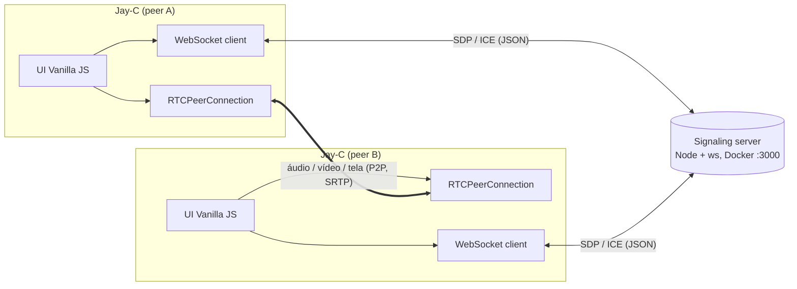

# Jay-C — Arquitetura

App leve e open-source de chamadas e compartilhamento de tela, para desktop e mobile, com servidor de sinalização self-hosted via Docker.

## 1. Visão geral



- O servidor **só troca mensagens de sinalização**: oferta, resposta e candidatos ICE. Mídia nunca passa por ele, então ele consome quase nada de CPU e RAM.
- A mídia vai direto entre os peers. Em LAN, ZeroTier ou Radmin VPN, os candidatos ICE do tipo *host* bastam, sem STUN ou TURN. Para uso pela internet sem VPN, o servidor repassa aos clientes os STUN/TURN definidos em `ICE_SERVERS`. Um serviço coturn opcional no compose fica para a etapa de release.
- Topologia: **1:1 primeiro**. Depois, mesh para salas pequenas (até 4 pessoas). Acima disso precisaria de SFU, que está fora do escopo.

## 2. Decisões técnicas

| Tema | Escolha | Motivo |
|---|---|---|
| Framework UI | **Vanilla JS + Vite** | Zero runtime de framework, menor memória e bundle. A UI é pequena: chamada, configurações e modal. |
| Shell | **Tauri v2** | Usa a WebView do sistema (WebView2, WKWebView, Android WebView) em vez de embutir o Chromium. |
| Servidor | **Node.js + `ws`** (não Socket.io) | O cliente usa o `WebSocket` nativo da WebView, sem lib extra no bundle. O protocolo é JSON simples e a imagem Docker fica mínima (`node:alpine`). |
| Negociação | Padrão **"perfect negotiation"** (W3C) | Resolve colisões de oferta (glare) e permite renegociar adicionando ou removendo faixas sem derrubar a chamada. |
| Troca de qualidade | `track.applyConstraints()` + `RTCRtpSender.setParameters()` | Muda resolução, FPS e bitrate **sem renegociar SDP**. Para trocar a fonte (câmera ↔ tela) usa `sender.replaceTrack()`, também sem renegociar. |
| Tema | CSS Custom Properties em `:root[data-theme]` | A troca é instantânea, só muda um atributo. Respeita `prefers-color-scheme` no primeiro uso. |
| Markdown do guia | Renderer próprio (~80 linhas) | O conteúdo é nosso e controlado. Basta suportar títulos, negrito, `code`, imagens e parágrafos, sem dependência extra. Escapa HTML por padrão. |
| Assets do guia | `frontend/public/assets/setup/*.png` | A pasta `public/` do Vite é servida na raiz pelo Tauri. `src-tauri/icons/` é só para ícones do app. |
| Persistência | `localStorage` | Guarda endereço do servidor, tema, preset de qualidade e nome. |

## 3. Estrutura do monorepo

```
JayC/
├─ package.json                 # npm workspaces: frontend, signaling-server, plugin guest-js
├─ docs/ARQUITETURA.md
├─ signaling-server/
│  ├─ src/server.js             # HTTP (/health) + WebSocketServer
│  ├─ src/rooms.js              # salas, peers, roteamento de mensagens
│  ├─ test/                     # node:test — join/leave/relay/limites
│  ├─ Dockerfile                # node:22-alpine, usuário não-root, HEALTHCHECK
│  ├─ docker-compose.yml        # porta 3000; coturn opcional (profile "turn")
│  └─ .dockerignore
├─ frontend/
│  ├─ index.html
│  ├─ vite.config.js
│  ├─ public/assets/setup/step1_docker.png … step5_connect.png
│  ├─ src/
│  │  ├─ main.js
│  │  ├─ styles/theme.css       # tokens claro/escuro
│  │  ├─ core/signaling.js      # WS client com reconexão + heartbeat
│  │  ├─ core/peer.js           # RTCPeerConnection + perfect negotiation
│  │  ├─ core/media.js          # getUserMedia / getDisplayMedia
│  │  ├─ core/quality.js        # presets → constraints + sender params
│  │  ├─ core/pip.js            # abstração de PiP por plataforma
│  │  ├─ core/platform.js       # detecta desktop/android/ios via @tauri-apps/plugin-os
│  │  ├─ ui/call-view.js, ui/settings-modal.js, ui/setup-guide-modal.js
│  │  ├─ ui/markdown.js         # renderer mínimo
│  │  ├─ content/setup-guide.md # importado com ?raw
│  │  └─ store/settings.js
│  └─ src-tauri/
│     ├─ tauri.conf.json, Cargo.toml, capabilities/default.json
│     ├─ src/lib.rs, src/main.rs
│     └─ gen/android, gen/apple # gerados por `tauri android|ios init`
└─ plugins/tauri-plugin-pip/
   ├─ src/lib.rs, src/mobile.rs, src/desktop.rs, src/commands.rs
   ├─ android/src/main/java/.../PipPlugin.kt
   ├─ ios/Sources/PipPlugin.swift
   └─ guest-js/index.js         # enterPip(), isPipSupported(), onPipChanged()
```

## 4. Protocolo de sinalização (JSON via WebSocket)

Cliente → servidor:

| type | campos | |
|---|---|---|
| `join` | `room`, `name` | entra na sala (cria se não existir) |
| `signal` | `to`, `data` (`{description}` ou `{candidate}`) | repassado só para `to` |
| `leave` | — | sai da sala |

Servidor → cliente:

| type | campos | |
|---|---|---|
| `joined` | `id`, `room`, `peers: [{id, name}]`, `iceServers` | confirmação, quem já está na sala e os STUN/TURN configurados no servidor (`ICE_SERVERS`) |
| `peer-joined` / `peer-left` | `id`, `name` | |
| `signal` | `from`, `data` | |
| `error` | `code` (`room-full`, `bad-message`, `rate-limited`, `not-in-room`, `unknown-peer`), `ref` opcional | |

Configuração por variáveis de ambiente: `PORT` (3000), `HOST` (0.0.0.0), `MAX_PEERS_PER_ROOM` (4), `MAX_MESSAGE_BYTES` (65536), `HEARTBEAT_MS` (30000), `ALLOWED_ORIGINS` (vazio = qualquer), `ICE_SERVERS` (JSON).

Proteções:
- Mensagem de no máximo 64 KB, no máximo 4 peers por sala e limite de mensagens por segundo.
- Ping/pong a cada 30 s para derrubar conexões mortas.
- IDs de peer gerados pelo servidor, com `crypto.randomUUID()`.
- Endpoint `GET /health` para o `HEALTHCHECK` do Docker.

## 5. Fluxos principais

**Iniciar chamada.** O app conecta em `ws://<ip>:3000` e envia `join`. Quem chega por último é quem oferece: para cada peer que já está na sala, cria um `RTCPeerConnection` com um data channel `control` e um transceiver `sendrecv` por tipo de mídia (áudio e vídeo). Isso dispara a oferta. Quem já estava na sala adota esses transceivers ao responder. Colisões posteriores seguem o "perfect negotiation": o recém-chegado é *impolite*.

**Estado da mídia.** O data channel `control` carrega mensagens JSON como `{type: "media", audio, video}`. Elas são necessárias porque o Chrome não marca a faixa remota como *muted* quando o outro lado para de enviar com `replaceTrack(null)`. Com elas, o avatar e o ícone de microfone mudo aparecem na hora.

**Queda do servidor.** As conexões P2P continuam durante a queda e um aviso aparece na tela. O cliente reconecta com backoff (1, 2, 4, 8 e 10 s) e recebe um novo id. Aí as conexões são refeitas com quem estiver na sala.

**Compartilhar tela.** Chama `getDisplayMedia({video, audio})`. Se já existe um sender de vídeo, usa `replaceTrack()`. Senão, `addTrack()`, que renegocia automaticamente. Ajusta `track.contentHint` para `detail` (texto e código) ou `motion` (jogos e vídeo).

**Mudar qualidade durante a chamada.**
1. `track.applyConstraints({width, height, frameRate})` muda a captura na origem.
2. `sender.setParameters()` com `encodings[0].maxBitrate`, `maxFramerate` e `scaleResolutionDownBy` muda o encoder.
3. Não há renegociação nem queda. Se o `applyConstraints` falhar (algumas WebViews não aceitam em tela), o fallback é capturar de novo e usar `replaceTrack()`.

Presets: resolução 360p, 480p, 720p, 1080p, 1440p ou original. FPS 5, 15, 24, 30 ou 60. Bitrate automático ou com teto.

## 6. Picture-in-Picture

`core/pip.js` expõe uma única API, `pip.enter(videoEl)`, e escolhe a implementação:

| Plataforma | Implementação |
|---|---|
| Windows (WebView2/Chromium) | `video.requestPictureInPicture()`. Se existir `documentPictureInPicture`, usa Document PiP com controles (mudo, desligar). |
| macOS (WKWebView) | `video.requestPictureInPicture()` (Safari 13.1+) |
| Linux (WebKitGTK) / fallback geral | **Mini-janela Tauri**: `WebviewWindow` pequena com `alwaysOnTop: true`, sem decoração, exibindo o stream remoto |
| Android | Plugin Kotlin: `activity.enterPictureInPictureMode(PictureInPictureParams)` com aspect ratio 16:9. `setAutoEnterEnabled(true)` (API 31+) ou `onUserLeaveHint` entram em PiP sozinhos quando o app vai para segundo plano. Manifest: `android:supportsPictureInPicture="true"` e `resizeableActivity`. |
| iOS | Plugin Swift: `AVPictureInPictureController` com `AVPictureInPictureVideoCallViewController` (iOS 15+), `canStartPictureInPictureAutomaticallyFromInline = true` e background modes `audio` + `voip`. Alternativa mais simples a avaliar: `video.webkitSetPresentationMode('picture-in-picture')` do próprio WKWebView. |

## 7. Riscos conhecidos (importante)

1. **Compartilhar tela no mobile não funciona via `getDisplayMedia`.** Android WebView e iOS WKWebView não implementam essa API.
   - Android exige captura nativa com `MediaProjection` + foreground service, e o vídeo precisa voltar para o WebRTC. Isso é complexo.
   - iOS exige uma *Broadcast Upload Extension* (ReplayKit).
   - Proposta: **no mobile, o v1 só recebe tela e faz chamada de câmera e áudio**. Compartilhar tela pelo celular fica para uma fase posterior.
2. **iOS só compila num Mac com Xcode.** Neste PC Windows dá para escrever o código Swift, mas não para compilar nem testar.
3. **Linux/WebKitGTK** tem suporte parcial a `getDisplayMedia` e WebRTC, dependendo da versão. O alvo principal é Windows, com macOS em seguida.
4. **Permissões no Android**: câmera e microfone precisam estar declarados no manifest e ser concedidos em runtime. A WebView também precisa aceitar o `onPermissionRequest`. Isso será validado na etapa Android.
5. **Guia de setup**:
   - Para `docker compose up -d` "baixar o servidor automaticamente", a imagem precisa estar **publicada num registry** (GHCR ou Docker Hub). Isso exige um repositório GitHub público.
   - O comando atual é `docker compose` (com espaço). `docker-compose` é o v1, descontinuado. Vou ajustar o texto do guia.
6. **Firewall do Windows** no host precisa liberar a porta 3000. Vale citar no guia.

## 8. Ferramentas necessárias

| Ferramenta | Para quê | Status nesta máquina |
|---|---|---|
| Node.js + npm | frontend, servidor, Tauri CLI | ✅ v24.21 / 11.19 |
| Git | versionamento | ✅ |
| WebView2 | runtime do Tauri no Windows | ✅ 156 |
| WSL2 | backend do Docker Desktop | ✅ (Ubuntu) |
| **MS C++ Build Tools** (VS 2022, "Desktop development with C++") | linker do Rust no Windows | ❌ |
| **Rust** (rustup, toolchain MSVC) | compilar Tauri e plugins | ❌ |
| **Docker Desktop** | testar a imagem do servidor | ❌ |
| **Android Studio** (inclui JDK) + SDK, NDK e cmdline-tools | build Android | ❌ |
| Alvos Rust Android (`aarch64-linux-android` etc.) | build Android | ❌ (depois do Rust) |
| Xcode | build iOS | ⛔ impossível no Windows |

O Tauri CLI entra como `devDependency` (`@tauri-apps/cli`), sem instalação global.

## 9. Etapas de implementação

Cada etapa termina com algo testável.

| # | Etapa | Pronto quando |
|---|---|---|
| 0 | Instalar ferramentas | `rustc`, `cargo`, `docker` e `java` respondem. `npx tauri info` sem erros. |
| 1 | Scaffold do monorepo + `git init` | `npm install` na raiz funciona |
| 2 | Servidor de sinalização + testes | `npm test` passa e dois clientes `wscat` trocam mensagens |
| 3 | Docker do servidor | `docker compose up -d` sobe e `/health` responde 200 |
| 4 | Frontend base: Vite + Tauri desktop, tema, settings | `npm run tauri dev` abre a janela e o tema alterna na hora |
| 5 | Chamada 1:1 (câmera/mic) | duas instâncias do app se veem e se ouvem via servidor local |
| 6 | Compartilhar tela + controles de qualidade | resolução e FPS mudam no meio da chamada sem cair (confirmado em `getStats()`) |
| 7 | PiP desktop | o vídeo remoto flutua sobre outras janelas |
| 8 | Modal do guia + renderer Markdown + imagens | o guia renderiza com as 5 imagens nos dois temas |
| 9 | Android: `tauri android init`, permissões, plugin PiP Kotlin | o APK roda no emulador ou no celular, entra em chamada e vai para PiP ao minimizar |
| 10 | iOS: plugin Swift (código) | código escrito; build pendente de um Mac |
| 11 | Release: imagem no GHCR + bundles Tauri (`.msi`/`.exe`, `.apk`) | o guia de 5 passos funciona do zero numa máquina limpa |
